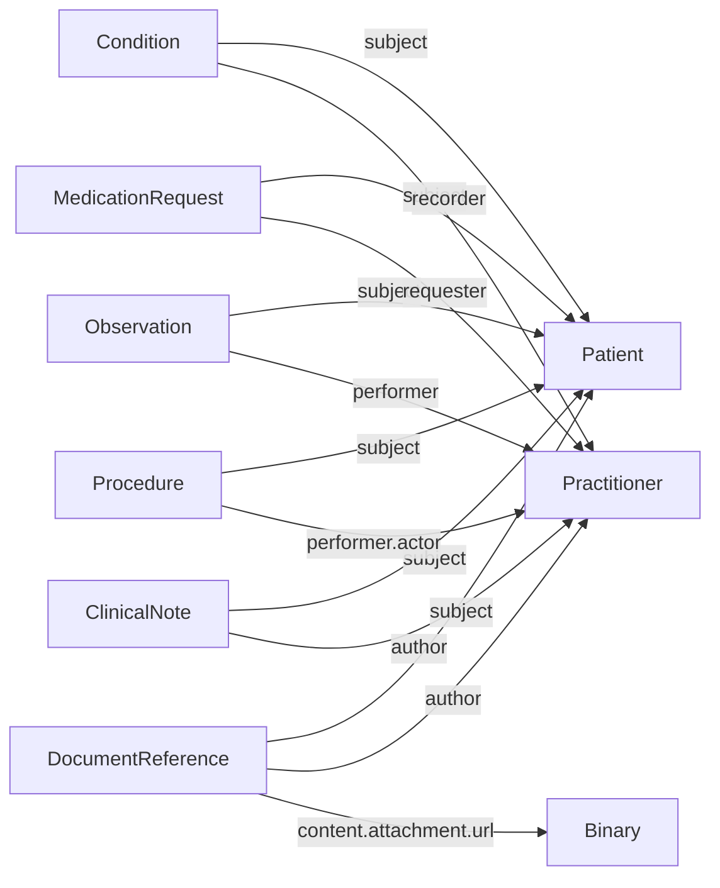

# Data model

How the sample data in `resources/fhir-resources.txt` is organised and how the resources connect to each other.

This describes the data as intended, assuming it's clean. For the actual problems in the file, see [data-quality-report.md](data-quality-report.md).

## The file

The file is newline-delimited JSON: one FHIR resource per line, each with a `resourceType` and an `id`. The API loads it at startup and stores each resource by type and id (see `load_resources` in `app/main.py`). A resource is fetched with `GET /{resourceType}/{id}`, e.g. `GET /Patient/noah-wyle`.

## Resource types

| Type | What it represents | Key fields |
|---|---|---|
| **Patient** | A person receiving care. 16 patients. | `name`, `gender`, `birthDate`, `active` |
| **Condition** | A diagnosis, such as hypertension or asthma. | `code` (SNOMED CT), `clinicalStatus`, `verificationStatus`, `onsetDateTime`, `abatementDateTime` |
| **MedicationRequest** | A prescription. | `medicationCodeableConcept` (RxNorm), `status`, `intent`, `dosageInstruction`, `authoredOn` |
| **Observation** | A measurement or finding: vitals, lab results, smoking status. | `code` (LOINC), `valueQuantity` or `valueString`, `component` (for blood pressure), `effectiveDateTime` |
| **Procedure** | Something done to the patient, such as a colonoscopy or angiography. | `code` (SNOMED CT), `status`, `performedDateTime` |
| **DocumentReference** | Information about a clinical document: its type, date and author. | `type` (LOINC), `date`, `content[].attachment` |
| **Binary** | A document's raw content, base64-encoded. | `contentType`, `data` |
| **ClinicalNote** | A free-text note. Custom to this dataset, not a standard FHIR type. | `content`, `date` |

**Practitioner** is referenced throughout but has no records in the file. It represents the clinician who recorded, ordered, performed or wrote something.

## How they connect



- **Everything points to a Patient.** Every clinical resource has a `subject` reference like `{"reference": "Patient/noah-wyle", "display": "Noah Wyle"}`. The `reference` is the actual link; `display` is only a label for people to read.
- **Clinicians are attached by role.** The field name says what the clinician did: `recorder` (diagnosed), `requester` (prescribed), `performer` (measured or operated), `author` (wrote). On Observations, `performer` is optional.
- **Documents come in two parts.** A DocumentReference holds information about the document and points to a Binary that holds the content: `content[0].attachment.url` is `"Binary/binary-001"`. This is a URL, not a FHIR reference object.
- **Links go one way.** A Patient record contains no links. To find everything about a patient, look for resources whose `subject.reference` is that patient.
- **Clinical records aren't linked to each other.** A prescription doesn't point to the condition it treats, and a procedure doesn't point to the condition behind it. They're related only because they share a patient.

## Example: one patient

Noah Wyle (`Patient/noah-wyle`) shows the full shape:

```
Patient/noah-wyle
├── Condition          Hypertension, Type 2 Diabetes, High Cholesterol
├── MedicationRequest  Lisinopril, Metformin, Atorvastatin
├── Observation        Blood pressure, HbA1c, cholesterol, weight, glucose, heart rate
├── Procedure          Colonoscopy, diabetic eye exam
├── ClinicalNote       Visit note (2025-01-05)
└── DocumentReference  Consult note ──► Binary/binary-001
```

The diagnoses, prescriptions and lab results match up clinically (hypertension → lisinopril → blood pressure readings), but only through the shared patient. The data has no field that says this prescription treats that diagnosis.

## Terminology

| Code system | Used for |
|---|---|
| SNOMED CT (`http://snomed.info/sct`) | Condition and Procedure codes |
| LOINC (`http://loinc.org`) | Observation codes, DocumentReference type |
| RxNorm (`http://www.nlm.nih.gov/research/umls/rxnorm`) | Medication codes |
| UCUM (`http://unitsofmeasure.org`) | Units of measure |
| HL7 code systems (`terminology.hl7.org`) | Condition clinical and verification status |
